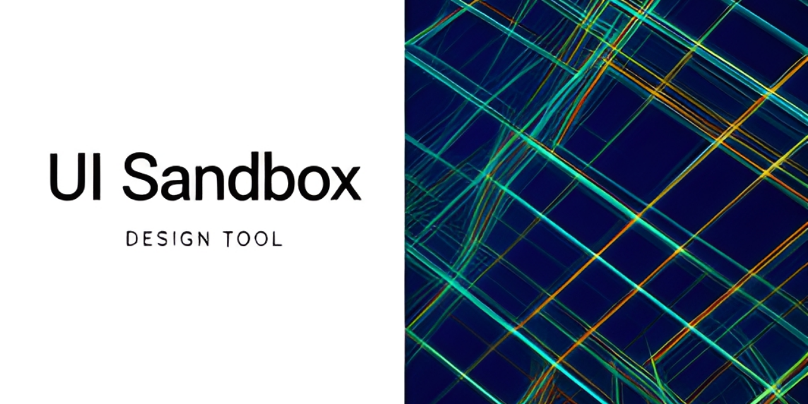

# UI Sandbox

<!-- aegean:media:start -->
<p align="center"></p>
*The banner and logo are AI-generated brand assets. They are illustrative and may not literally depict every feature or the full project scope.*
<!-- aegean:media:end -->

[](https://github.com/AegeanWorks/AIKit)

A small React + Vite surface for exercising AIKit's bounded UI guard. The app is deliberately
simple: one screen, token-driven theming, and a labelled control for every interaction.

## ⚡ 30-Second Cold-Start Quick Reference

- **Runtime Prerequisites**: Node.js 20+ and npm 10+ (Node 26 tested).
- **Canonical Regression Shield Gate**:
  ```bash
  npm test
  ```

### 🛠️ Commands

| Role | Command |
|---|---|
| Install dependencies | `npm install` |
| Run the dev server | `npm run dev` |
| Run the Node test suite | `npm test` |
| Build the production bundle | `npm run build` |
| Print the UI inventory | `npm run ui:snapshot` |

GitHub Actions repeats the install, test, build and inventory steps on every push to `master` and
on every pull request (`.github/workflows/ci.yml`).

### 🛡️ AIKit UI Guard (run from the AIKit folder)

| Role | Command |
|---|---|
| Project status, task and gates | `python aikit.py status ui-sandbox` |
| Open a bounded task | `python aikit.py ui begin ui-sandbox --surface app` |
| Verify scope, fast proof and inventory | `python aikit.py ui verify ui-sandbox` |
| Close the task after review | `python aikit.py ui finish ui-sandbox --reviewed` |
| Phase 4: every gate | `python aikit.py check ui-sandbox` |

The committed contract `.aikit/ui.json` bounds edits to `src/**`, runs `npm run build` as the
fast proof, and compares the `npm run ui:snapshot` inventory so a lost control is a finding.
Color and font literals may live only in `src/theme.css`; every other stylesheet uses tokens.

## 📦 What's Inside

```text
ui-sandbox/
├── .github/
│   └── workflows/
│       └── ci.yml
├── .gitignore
├── LICENSE
├── LICENSES/
│   └── LicenseRef-AL-1.1.txt
├── REUSE.toml
├── README.md
├── COMMERCIAL.md
├── index.html
├── package.json
├── package-lock.json
├── vite.config.js
├── scripts/
│   ├── inventory-core.mjs
│   └── ui-inventory.mjs
├── src/
│   ├── App.jsx
│   ├── main.jsx
│   ├── styles.css
│   └── theme.css
├── tests/
│   ├── app.test.mjs
│   └── inventory.test.mjs
└── .aikit/
    ├── decisions.md
    ├── guidelines.md
    ├── project.json
    ├── task_ledger.json
    ├── ui.json
    └── ui_history.json
```

## 🎨 UI Notes

- `data-ui` marks every interactive control and status readout.
- `data-panel` marks each layout panel.
- `scripts/inventory-core.mjs` turns those attributes into the sorted inventory lines that
  `npm run ui:snapshot` prints; `tests/app.test.mjs` keeps the control list honest.

## 📜 License

Free for personal use under the Aegean License 1.1 (AL-1.1); see [LICENSE](LICENSE). Any commercial use needs the Aegean Commercial License 1.0 (ACL-1.0); see [COMMERCIAL.md](COMMERCIAL.md).
